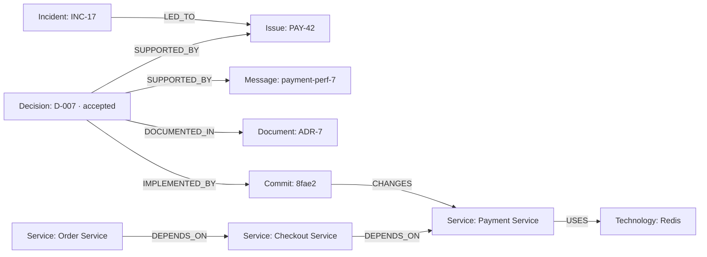
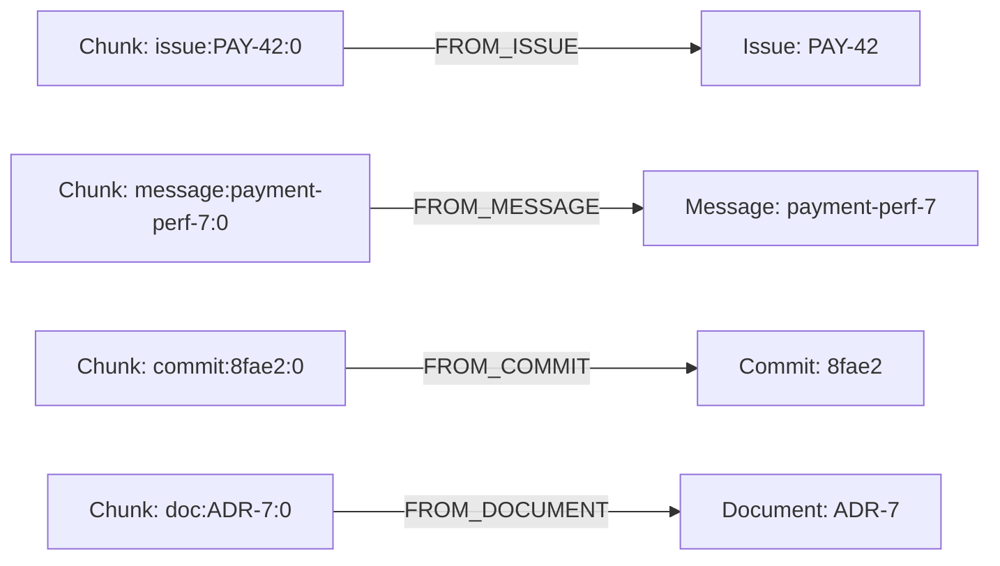
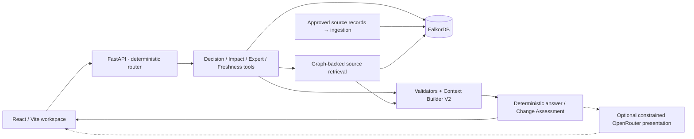
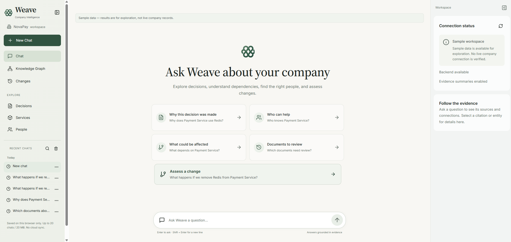
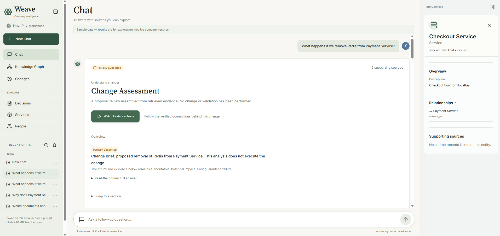
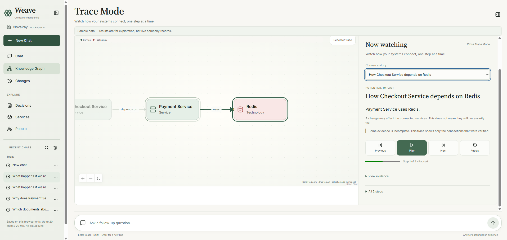
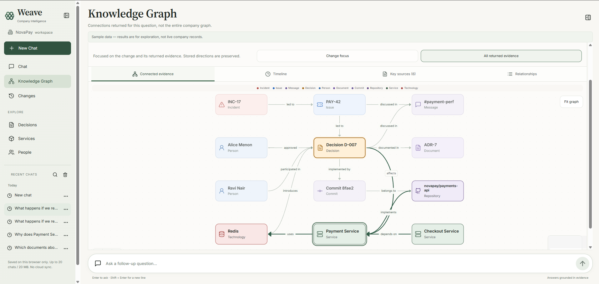

# Weave — Evidence-Grounded Company Intelligence

Understand **why a system works this way, what depends on it, who can help, and what a proposed change could affect**—with sources and graph paths you can inspect.

Built for **FalkorDB Graph Hacks · Track 3: Company Brain**.

Company knowledge is scattered across incident reports, issues, discussions, decisions, commits and documents. A matching document alone rarely explains how those records connect. Weave stores their directed relationships in FalkorDB, retrieves the relevant evidence, and turns it into a grounded answer or Change Assessment.

**Try the signature question:** “What happens if we remove Redis from Payment Service?”

The result separates historical rationale, potential impact, relevant reviewers, known facts, inferred risks, unperformed checks and document-review recommendations. **Watch Evidence Trace** follows the actual returned relationships through the existing graph.

## What you can do

| Feature | What it gives you |
| --- | --- |
| **Change Intelligence** | A structured Change Assessment combining all four graph capabilities for the supported proposal. |
| **Cinematic Trace Mode** | Play, pause and step through backend-validated Decision and Impact paths, with edge animation, camera framing and reduced-motion support. |
| **Decision Trace** | Follow an accepted architectural decision to its supporting issue/discussion, implementation and documentation. |
| **Impact Analysis** | Find direct and downstream dependents through stored relationships; potential impact is not a prediction of failure. |
| **Expert Finder** | Rank relevant contributors from approval, participation, authorship, assignment, discussion and team evidence. |
| **Knowledge Freshness** | Identify documents worth reviewing because associated changes occurred later. A review recommendation does not prove a document is wrong. |
| **Interactive Knowledge Graph** | Search, fit and inspect the evidence returned for an answer, including sources and directed connections. |
| **Persistent Chat History** | Create, search, rename and reopen independent conversations and saved Change Assessments locally, without rerunning analysis. |

## How Weave Uses FalkorDB

### The graph behind the NovaPay example

These are actual relationships produced by the [NovaPay ingestion mapping](weave_data/relationships.py) and [dataset](data/novapay). Arrows show **stored direction**, including dependencies pointing from the dependent service to its dependency.



The decision also `AFFECTS` Payment Service and `INTRODUCES` Redis. People contribute through explicit relationships: for example, **Alice Menon —APPROVED→ D-007**, and **Alice Menon —MEMBER_OF→ Payments team —OWNS→ Payment Service**. Team membership does not establish individual ownership. **Commit —BELONGS_TO→ Repository —IMPLEMENTS→ Service** connects implementation to its repository and service.

This is a set of supporting paths, **not an invented incident → discussion → decision chronology**. In particular, `SUPPORTED_BY` points **from D-007 to PAY-42**, not the reverse.

### Source and chunk provenance

Text comes from persisted `Chunk` nodes with canonical source IDs, text, index, timestamp and URL metadata. Each illustrated chunk has its own parent source:



The displayed chunk labels omit only the common `chunk:` ID prefix. Rationale requires the retrieved **Decision —SUPPORTED_BY→ Issue/Message ←FROM_*— Chunk** path and matching source/chunk provenance. A nearby document or graph node cannot become a rationale citation by proximity.

### Show the graph doing the work

For **“What happens if we remove Redis from Payment Service?”**:

1. **Detect the proposal deterministically.** The bounded resolver selects the supported service/technology pair; it still requires a retrieved `Payment Service —USES→ Redis` relationship.
2. **Decision Trace queries FalkorDB** for the accepted decision, supporting records, implementation, documentation and explicitly returned ordered paths.
3. **Impact Analysis walks dependents:** Redis → Payment → Checkout → Order is the traversal order. Stored arrows remain Payment `USES` Redis, Checkout `DEPENDS_ON` Payment and Order `DEPENDS_ON` Checkout.
4. **Expert Finder retrieves contribution paths** and applies fixed evidence-category scores to select relevant reviewers. The model cannot change rankings.
5. **Knowledge Freshness checks document associations and dates** against later accepted decisions, architecture-changing commits and incidents. Current review candidates remain separate from documents to review **if the proposal is approved and implemented**.
6. **Capability validators, orchestration and Context Builder V2** validate tool-local paths, retrieve deduplicated source IDs, preserve chunk provenance and merge compatible evidence. A sibling tool cannot repair a missing proof.
7. **Change Intelligence builds the assessment:** known facts, inferred risks and recommendations remain distinct; proposed validation checks are marked **not performed**.
8. **Optional OpenRouter presentation** selects constrained, server-authored sections. Invalid selections, unsupported citations or provider failures retain the deterministic answer.
9. **Trace Mode animates validated ordered relationships.** Every step must match an exact directed edge in its original tool evidence. Playback does not issue a query per step or infer missing edges.

**FalkorDB determines the factual evidence; the language model only presents validated information.** Removing FalkorDB removes real multi-hop discovery, decision-to-implementation paths, reviewer evidence, freshness associations and chunk-backed retrieval. The graph is not merely a visualization layer. Routing is deterministic, not an autonomous LLM choosing Cypher.

For example, the [actual Decision Trace query](app/graph/trace.py) retrieves the incident through the selected decision's supporting issue:

```cypher
MATCH (d:Decision {id: $decision_id})-[:SUPPORTED_BY]->(issue:Issue)
MATCH (i:Incident)-[r:LED_TO]->(issue)
RETURN i, r, issue
ORDER BY i.id, issue.id
LIMIT 20
```

Core query implementations: [Decision Trace](app/graph/trace.py), [Impact Analysis](app/graph/impact.py), [Expert Finder](app/graph/experts.py), [Knowledge Freshness](app/graph/freshness.py). [Graph-backed source retrieval](weave_data/graph_adapter.py) supplies persisted chunks; [Context Builder V2](backend/app/context_v2.py) preserves each capability's provenance.

## Architecture



React Flow displays the returned evidence. IndexedDB stores conversations in the browser. Backend graph tools use the `weave_graph` compatibility namespace; ingestion/retrieval live in `weave_data`. No vector database, embedding service or hosted model is required for the canonical deterministic workflow.

## Quick start: the real graph workflow

Prerequisites: **Python 3.11+**, **Node.js 20.19+ or 22.12+** (Node 24 was used in recorded frontend checks), and **Docker with Compose**, or an existing compatible FalkorDB instance. Use a fresh clone and an isolated local demonstration graph for ingestion.

From the repository root in **Windows PowerShell**:

```powershell
python -m venv .venv
.\.venv\Scripts\python.exe -m pip install -r backend\requirements.lock.txt
npm.cmd --prefix frontend ci
Copy-Item .env.example .env
```

Do not overwrite an existing `.env`; retain your own configuration. The backend lockfile includes FastAPI, the FalkorDB client, Pydantic, pytest and Ruff; the smaller root `requirements.txt` covers the ingestion workstream only. No PowerShell activation script is required.

### 1. Configure and prepare the dataset

Keep these values in the ignored `.env` for the local full workflow:

```dotenv
WEAVE_GRAPH_MODE=falkordb
WEAVE_GRAPH_FACTORY=app.antony:create_gateway
WEAVE_SOURCE_BACKEND=weave_data
WEAVE_GRAPH_NAME=novapay
WEAVE_FALKORDB_HOST=localhost
WEAVE_FALKORDB_PORT=6379
WEAVE_LLM_PROVIDER=none
```

Start the repository's local FalkorDB container and validate the bundled, approved synthetic NovaPay corpus:

```powershell
docker compose up -d falkordb
.\.venv\Scripts\python.exe -m weave_data.ingest --prepare-only
.\.venv\Scripts\python.exe -m weave_data.ingest --host localhost --port 6379 --graph novapay
```

Prepare-only validates without persisting. Full ingestion uses idempotent upserts and must succeed against FalkorDB; it never silently substitutes an in-memory graph. The current corpus prepares **20 entities, 6 chunks and 44 relationships**. Ingestion writes to the selected graph; use an owned local instance, not an unrelated shared graph.

The CLI uses explicit flags or `FALKORDB_*` process variables, not the backend's `.env` loader. Keep host, port and graph aligned. [Remote credentials/TLS and platform-neutral setup](docs/RUNNING.md) cover the programmatic adapter when the CLI's local options are insufficient.

### 2. Start FastAPI and Vite

Terminal 1, repository root:

```powershell
.\.venv\Scripts\python.exe -m uvicorn app.main:app --app-dir backend --host 127.0.0.1 --port 8000
```

Terminal 2, repository root:

```powershell
npm.cmd --prefix frontend run dev
```

Open **http://127.0.0.1:5173**. Vite proxies `/api` to FastAPI on port 8000. API documentation is at **http://127.0.0.1:8000/docs**.

With deterministic mode still enabled, check health and evaluate the canonical scenario:

```powershell
Invoke-RestMethod http://127.0.0.1:8000/api/health
Invoke-RestMethod http://127.0.0.1:8000/api/change-intelligence -Method Post -ContentType 'application/json' -Body '{"target":"Payment Service","change":"Remove Redis from Payment Service"}'
```

Then ask **“What happens if we remove Redis from Payment Service?”** in Chat and select **Watch Evidence Trace**. Inspect PAY-42, payment-perf-7, ADR-7 and commit 8fae2 independently of the graph-only playback. The canonical assessment is conservatively `partially_supported`: stored dependencies do not prove failure propagation. An unavailable real graph returns **503 / GRAPH_UNAVAILABLE**, not synthetic evidence.

### Explicit development fixture mode

For a limited UI/API preview without FalkorDB, start a separate backend terminal with:

```powershell
$env:WEAVE_GRAPH_MODE = 'fixture'
$env:WEAVE_LLM_PROVIDER = 'none'
.\.venv\Scripts\python.exe -m uvicorn app.main:app --app-dir backend --host 127.0.0.1 --port 8000
```

The UI labels these results **Sample data**. The runtime fixture gateway supplies Decision Trace and selected precomputed Impact examples; Expert Finder and Knowledge Freshness return qualified empty results. A fixture Change Assessment is incomplete and is **not** a substitute for the four-tool, graph-backed workflow or live Trace acceptance. Test-only rich browser fixtures are not runtime retrieval fallbacks. Restart without the shell overrides to return to `.env` real mode.

## Configuration

Backend settings load the root `.env`; process environment variables take precedence. See [`.env.example`](.env.example) and [settings](backend/app/config.py).

| Setting | Purpose / example |
| --- | --- |
| `WEAVE_GRAPH_MODE` | `falkordb` for real tools; `fixture` must be explicitly selected. |
| `WEAVE_GRAPH_FACTORY` | `app.antony:create_gateway` integrates the merged graph tools. |
| `WEAVE_SOURCE_BACKEND` | `weave_data` uses persisted graph source retrieval; `delegate` is the replaceable integration boundary. |
| `WEAVE_GRAPH_NAME`, `WEAVE_FALKORDB_HOST`, `WEAVE_FALKORDB_PORT` | Align the backend with the ingested graph. |
| `WEAVE_FALKORDB_USERNAME`, `WEAVE_FALKORDB_PASSWORD`, `WEAVE_FALKORDB_SSL` | Optional server credentials and TLS. Keep real values private. |
| `WEAVE_LLM_PROVIDER` | `none` runs deterministically; `openrouter` enables constrained hosted presentation. `ollama` remains an optional legacy single-tool path. |
| `WEAVE_OPENROUTER_API_KEY` | Optional backend-only secret; `OPENROUTER_API_KEY` is an alias. Never place it in `VITE_*`. |
| `WEAVE_LLM_MODEL` | `openai/gpt-oss-120b`; `LLM_MODEL` is an alias. |
| `WEAVE_OPENROUTER_MAX_TOKENS`, `WEAVE_LLM_TIMEOUT_SECONDS` | Example values: `1200`, `30`. |
| `WEAVE_CORS_ORIGINS` | JSON array of permitted frontend origins. |
| `VITE_API_URL` | Optional frontend build-time backend URL; otherwise use a same-origin `/api` proxy. |

OpenRouter is optional. It may select/order validated server-authored content, not invent paths, change rankings, upgrade support or execute changes. Rejected/failed presentation falls back to the deterministic answer. Enabling it permits outbound provider requests, including availability checks; review what may leave your environment first. [Hosted presentation contract](docs/PHASE3_CHANGE_OPENROUTER_HANDOFF.md).

## Example questions

| Capability | Question |
| --- | --- |
| Change Intelligence | What happens if we remove Redis from Payment Service? |
| Decision Trace | Why does Payment Service use Redis? |
| Impact Analysis | What depends on Payment Service? |
| Expert Finder | Who knows Payment Service? |
| Knowledge Freshness | Which documents about Payment Service need review? |

Change Intelligence currently supports a **bounded Redis-removal proposal grammar for Payment Service**, not arbitrary architectural change planning. Unknown, ambiguous or unsupported targets remain qualified rather than guessed. [Resolver and four-tool plan](backend/app/change_intelligence.py).

## Screenshots

Actual supplied application captures, checked against the current committed Phase 4 UI. **All show explicitly labeled sample data; they demonstrate the interface, not live FalkorDB or hosted-model acceptance.** No fixture labels or results were edited out. [Asset provenance](docs/assets/README.md).

| Chat workspace | Change Assessment |
| --- | --- |
|  |  |
| Cinematic Trace | Knowledge Graph |
|  |  |

## API at a glance

| Endpoint | Role |
| --- | --- |
| `GET /api/health` | Separate backend, database/tool and provider availability. |
| `POST /api/query` | Deterministic routing, single or combined capabilities; six-field compatible response. |
| `POST /api/change-intelligence` | Dedicated structured Change Assessment and optional validated playback metadata. |
| `POST /api/tools/impact-analysis` | `entity_id` and bounded `max_depth`. |
| `POST /api/tools/expert-finder` | `query` and `limit`. |
| `POST /api/tools/freshness` | `entity`. |

`/api/query` retains `answer`, `support_status`, `tools_used`, `sources`, `graph`, `metadata`. The dedicated endpoints add their structured `data`; the UI does not rerun `/api/query` to reconstruct it. Endpoint models and bounds are defined in [the API models](backend/app/models.py).

## Tests and verification

From a fresh PowerShell with all `WEAVE_RUN_REAL_*` opt-ins unset:

```powershell
$env:PYTHONPATH = 'backend;.'
$env:WEAVE_SOURCE_BACKEND = 'delegate'
$env:WEAVE_LLM_PROVIDER = 'none'
.\.venv\Scripts\python.exe -m pytest backend/tests tests app/graph -q --basetemp=.local/pytest-readme
.\.venv\Scripts\python.exe -m ruff check backend/app backend/tests
npm.cmd --prefix frontend test -- --maxWorkers=2
npm.cmd --prefix frontend run lint
npm.cmd --prefix frontend run typecheck
npm.cmd --prefix frontend run build
git diff --check
```

Use a project-local pytest temporary directory on Windows. The delegate override isolates offline doubles from local real-source configuration; use a fresh shell for normal application startup afterward.

Recorded results: **370 frontend tests** plus ESLint, TypeScript and production build passed during Phase 4C; [Phase 4B](docs/PHASE4B_TRACE_MODE_HANDOFF.md) records **686 Python tests passed, 11 live tests skipped**, with scoped Ruff passing. These are recorded implementation checks, not a new test run by this README edit. [Phase 2 QA](docs/PHASE2_QA_REPORT.md) records earlier live FalkorDB acceptance at its stated code/dataset revisions; it does not establish combined Phase 3/4 live acceptance.

The live gates require an actual seeded FalkorDB, real adapters and explicit opt-in flags. The source-retrieval gate creates and deletes its own test graph; other gates inspect the seeded corpus. [Exact live commands and verification boundaries](docs/RUNNING.md#live-falkordb-checks). A skipped live test is not a pass.

## Limitations and privacy

- **Synthetic corpus:** NovaPay, its people and source records are demonstration data. Persisting them in a real database does not turn them into real company records.
- **Bounded scope:** the supported Change scenario is Redis removal from Payment Service. Directories and graph views show returned answer evidence, not a complete company inventory.
- **Structural evidence:** graph paths support stored relationships, not guaranteed outages, a complete causal chronology or approval to execute a change. Playback version 1 does not assign textual citations to graph-only steps.
- **Local history:** IndexedDB keeps saved evidence in this browser, with no cloud sync or account isolation. Limits are 20 chats, 40 turns per chat, 4 MiB per chat and 20 MiB total; one active writer tab is assumed.
- **Real-mode dependency:** unavailable graph/source evidence remains unavailable or qualified. Real mode never silently falls back to local files, fixtures or an in-memory graph.
- **Hosted privacy:** optional provider packets can contain necessary evidence IDs and fictional names. Keep credentials on the backend; review/approve data transmission before using private records. No new live hosted verification is claimed here.
- **No execution/failover:** Weave does not remove Redis, run proposed checks, create external tasks or provide verified PostgreSQL runtime failover. PostgreSQL in the dataset is architecture context, not a tested fallback implementation.

## Deployment

Intended topology: **HTTPS static frontend → FastAPI API → private FalkorDB with persistent storage**. Build `frontend/dist` with `npm.cmd --prefix frontend run build`; serve it with an `/api` reverse proxy, or set `VITE_API_URL` before building and configure matching backend CORS origins. `vite preview` alone does not provide the production API.

Deploy FastAPI as a separate Python service, provision/ingest the approved graph, configure backend secrets, and verify database/tool health plus the canonical query. Add access control and appropriate network boundaries before exposing company data: application authentication is not implemented. The local Compose file binds Redis protocol access to loopback; its `latest` image tag should be recorded/pinned by the release operator for reproducibility. Local startup binds FastAPI to `127.0.0.1`; a hosted service needs the platform's listener configuration.

**No public production URL or final combined live deployment was verified for this documentation update.** Complete local setup is provided above; deployment, demo-video publication and final submission remain explicit release tasks.

## Team and acknowledgements

Documented workstreams from the [team plan](docs/06_TEAM_PLAN.md) and integration handoffs:

| Team member | Workstream |
| --- | --- |
| Abhishikth S. Mattom | Backend/AI and product integration |
| Antony Jose | FalkorDB graph schema and graph tools |
| Alen Abraham Saji | NovaPay data, ingestion and source retrieval |
| Arnold Shibu | Frontend, demo and quality |

AI-assisted implementation used **OpenAI Codex**, as disclosed in the project documentation. Built with FalkorDB, FastAPI, React, Vite and React Flow; OpenRouter is an optional presentation provider.

[Documentation index](docs/README.md) · [Detailed run guide](docs/RUNNING.md) · [Submission checklist](docs/10_SUBMISSION_CHECKLIST.md)
